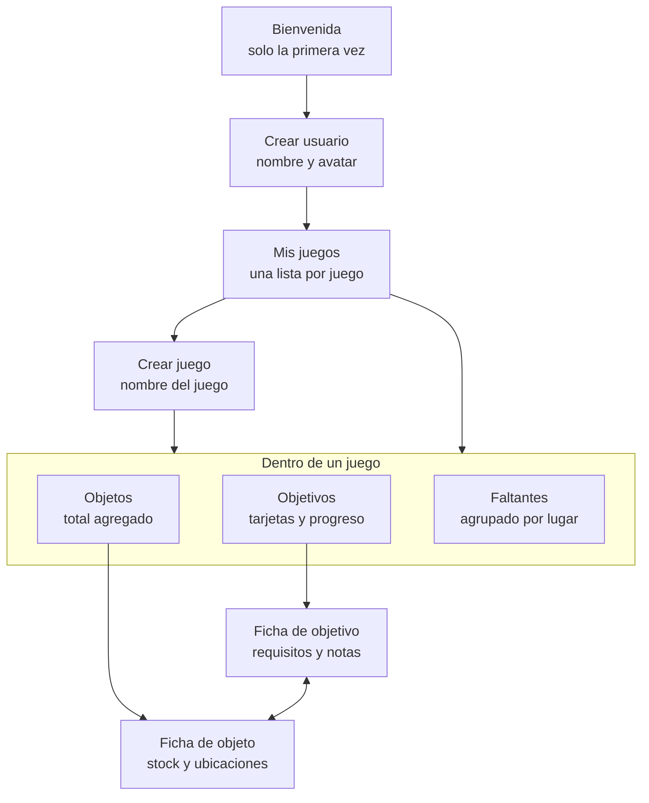
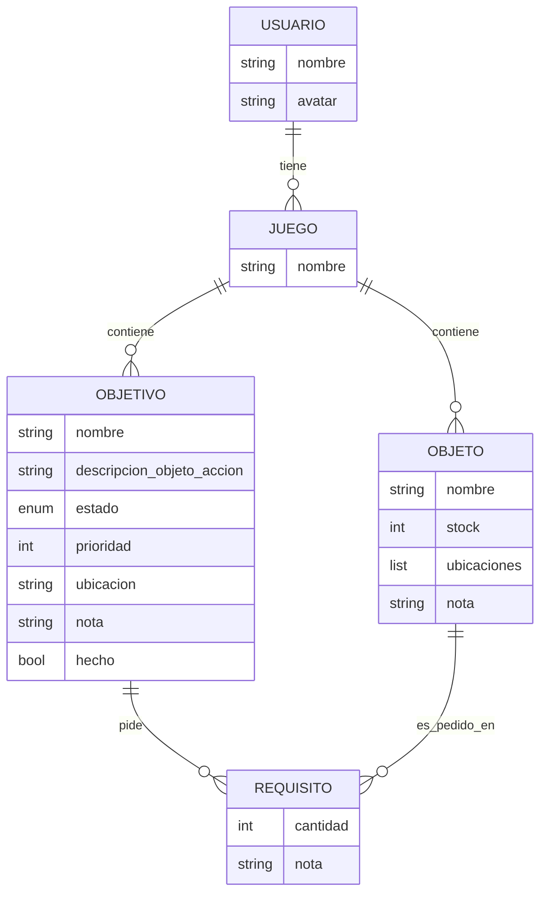

# Anotador gamer — Estructura de la aplicación

Anotador genérico para cualquier juego (autos, RPG, etc.). Permite registrar qué objetos faltan conseguir, en qué cantidad exacta y para qué finalidad, más recordatorios simples.

Alcance de este documento: estructura de datos y diagrama de visualización. Quedan fuera el stack, la lógica y el diseño de UI.

---

## 1. Idea central

Se separan tres conceptos que normalmente se mezclan en una sola lista:

| Concepto | Qué es | Ejemplo |
|---|---|---|
| Objeto | La cosa en sí. Existe una sola vez por juego. | Hierro, Créditos, Licencia A |
| Objetivo | La finalidad, el "para qué". | Forjar espada, Comprar el Skyline |
| Requisito | El vínculo: este objetivo necesita N de este objeto. | Espada necesita 5 de Hierro |

Un mismo objeto puede servir a varios objetivos sin duplicarse.

---

## 2. Jerarquía

```
Usuario (nombre, avatar)
└── Juego (una lista separada por juego)
    ├── Objetos
    ├── Objetivos
    │   ├── Requisitos (unen objetivo con objeto)
    └── Recordatorios (= objetivos sin requisitos)
```

Un juego es un espacio aislado: los objetos y objetivos de un juego no se mezclan con los de otro.

---

## 3. Entidades

### Usuario
- Nombre
- Avatar

### Juego
- Nombre
- Contiene todos sus objetos y objetivos

### Objeto
- Nombre
- Cantidad que tenés (stock)
- Ubicaciones: lista (zona, jefe, tienda, evento). Puede estar vacía si no se sabe
- Nota general

### Objetivo
- Nombre
- Estado: activo / pausado
- Prioridad
- Ubicación (opcional)
- Nota propia
- Texto libre de objeto/acción (`objectDescription`), por ejemplo «Juntar madera»
- Check de hecho (usado por los recordatorios)

### Requisito
- Objeto requerido
- Cantidad necesaria
- Nota específica del vínculo (ej: "solo dropea de noche"; aplica a este uso, no al objeto en general)

### Recordatorio
No es una entidad aparte: es un objetivo sin requisitos.
- Ejemplos: "Ir a Ciudad Paraíso", "Buscar a Merlin"
- Progreso binario (pendiente / hecho) en lugar de barra
- Se ve igual que el resto, solo cambia el indicador

---

## 4. Reglas

1. El progreso no se guarda: para cada requisito material se calcula como min(stock disponible ÷ cantidad necesaria, 1); una condición vale 100% si está marcada y 0% si no. El porcentaje de un objetivo es el promedio simple de sus requisitos directos. Un objetivo sin requisitos (recordatorio) usa su check pendiente/hecho.
2. Los requisitos que no son objetos (nivel 30, misión completada) se tratan como cantidad 1 con check. Entran en el mismo modelo.
3. Un objetivo mixto es válido: puede pedir 5 de Hierro y además el requisito "Hablar con Merlin".
4. Si un objeto u objetivo no tiene ubicación conocida, queda vacía y aparece en el grupo "Sin ubicación" de Faltantes. Eso marca qué falta investigar.
5. Los objetivos son planos; un recordatorio es un objetivo sin requisitos.
6. La vista agregada por objeto ignora los recordatorios (no tienen objeto que sumar). Aparecen en la vista por objetivo y en Faltantes.
7. En el MVP no se reserva stock. Cada objetivo calcula su avance usando el stock actual del objeto; por ello, el mismo stock puede contribuir al avance mostrado en varios objetivos. La vista agregada por objeto suma toda la demanda de sus requisitos y compara ese total con el stock común, que se descuenta una sola vez para obtener el faltante agregado.

---

## 5. Flujo de pantallas



---

## 6. Estructura de datos



---

## 7. Vistas

Las vistas no son datos distintos: son la misma base leída desde ángulos distintos. Nada se copia; se edita desde cualquiera y todas se actualizan. Los requisitos siguen asociados internamente a un objetivo y distinguen material de condición, aunque su creación se inicia desde el objetivo con acciones contextuales.

| Vista | Qué muestra |
|---|---|
| Por objetivo | Tarjeta por objetivo con barras de progreso por requisito (Hierro 3/5) y % total. Los recordatorios muestran un check. |
| Por objeto (agregada) | Total necesario por objeto con desglose: "20 Hierro: 5 para la Espada, 15 para la Armadura". Ignora recordatorios. |
| Faltantes | La vista agregada con el filtro de faltantes, agrupada por ubicación. Convierte la anotación en un plan de sesión. Incluye recordatorios. |

### Dos ejes que las combinan
1. Pivote: mirar desde el objetivo o desde el objeto.
2. Filtros y agrupaciones: solo faltantes, solo objetivos activos, agrupar por ubicación. Se aplican sobre cualquier pivote.

### Navegación entre vistas
- Tocar un requisito (Hierro 3/5) lleva a la ficha del objeto, con ubicación y notas.
- Tocar un total en la agregada (Hierro 20) despliega el desglose; tocar un ítem del desglose lleva a ese objetivo.
- Sumar stock desde cualquier lado actualiza el objeto, y las barras de todos los objetivos se mueven juntas.

---

## 8. Puntos abiertos


